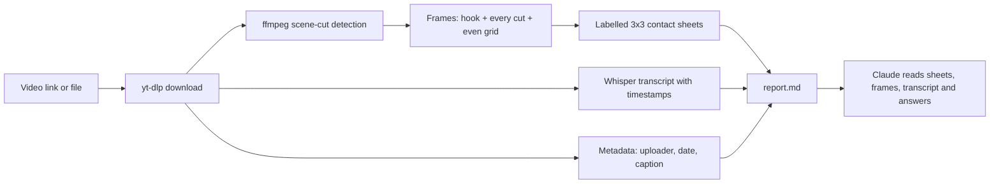

# video-watch

[](https://github.com/manishh-13/video-watch/actions/workflows/test.yml)
[](https://skills.sh/manishh-13/video-watch)

**An Agent Skill that lets Claude watch videos.**

Claude can read images and text but cannot play video. This skill bridges the gap: paste a reel, Short, TikTok or YouTube link (or a local file) and ask anything about it.

> "Is this video real?"
> "What actually happens in this reel?"
> "Break this ad down shot by shot so I can make one like it."

## How it works



`scripts/watch.py` turns the video into:

| Output | Why |
|---|---|
| `frames/` | Stills at the first 3 s (the hook), every scene cut and an even grid, file names carry the timestamp |
| `sheets/` | 3x3 contact sheets labelled `#frame mm:ss`, so one image shows 9 moments |
| `transcript.txt` | Speech with timestamps, any language (local faster-whisper, nothing leaves your machine) |
| `report.md` | Duration, cut times, cuts per second, uploader, upload date, caption, transcript |

The skill then tells Claude how to use it for three jobs:

- **Summary**: what happens, in order, with timestamps
- **Fact-check**: is the footage authentic (AI artefacts, edits, recycled clips) and are the claims true (each claim checked against sources, verdict and confidence per claim)
- **Ad / creative reference**: hook, shot list table, pacing, structure up to the CTA, and a beat-by-beat script adapted to your product

## Install

The only requirement is [uv](https://docs.astral.sh/uv/getting-started/installation/). The script declares its own dependencies (yt-dlp, a bundled ffmpeg, Pillow, faster-whisper), so there is no ffmpeg or pip install step.

**Claude Code** (plugin marketplace)

```
/plugin marketplace add manishh-13/video-watch
/plugin install video-watch@video-watch
```

**Claude Code** (manual): copy `skills/video-watch` into `~/.claude/skills/` (all projects) or `.claude/skills/` (one project).

**Any agent** via the [skills CLI](https://skills.sh):

```bash
npx skills add manishh-13/video-watch
```

**Claude.ai**: zip the `skills/video-watch` folder and upload it under Settings > Capabilities > Skills ([how](https://support.claude.com/en/articles/12512180-using-skills-in-claude)). The Claude.ai sandbox may not allow downloading videos or packages; if so, upload the video file itself.

## Use it directly

```bash
uv run --script skills/video-watch/scripts/watch.py "https://www.youtube.com/watch?v=jNQXAC9IVRw" --out ./video-watch-out/zoo
```

| Flag | Use |
|---|---|
| `--start S --end E` | Analyse only a window (seconds); zoom into a moment or a long video |
| `--max-frames N` | Default 36; raise for fast-cut reels |
| `--scene 0.2` | Cut sensitivity (default 0.3) |
| `--model small` | Better transcript (`tiny`, `base`, `small`, `medium`) |
| `--no-transcript` | Skip audio |
| `--cookies-from-browser chrome` | For sites that need you logged in (Instagram, some TikTok/Facebook) |

## Limits

- Claude sees sampled stills plus the transcript, not continuous motion. The skill makes Claude say so when a conclusion depends on motion (lip sync, physics, a fast trick).
- A fact-check verdict is evidence plus confidence, never a guarantee.
- First run downloads the Whisper model (about 150 MB for `base`).

Only download and analyse videos you have the right to, and follow each platform's terms.

## Test

```bash
bash tests/test_watch.sh   # offline: synthetic clip with 2 cuts, checks frames, sheets, cut detection
```

## License

MIT
